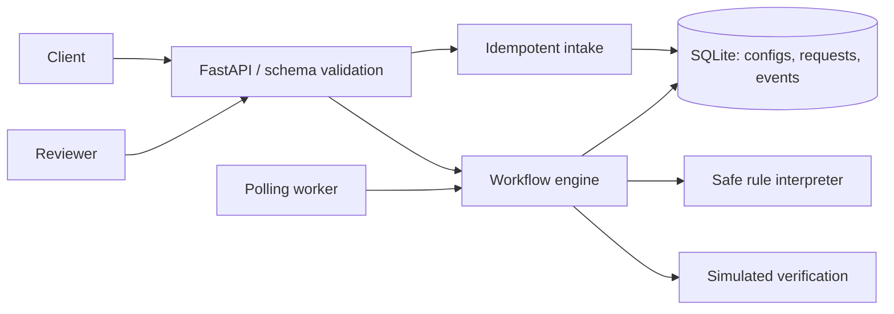
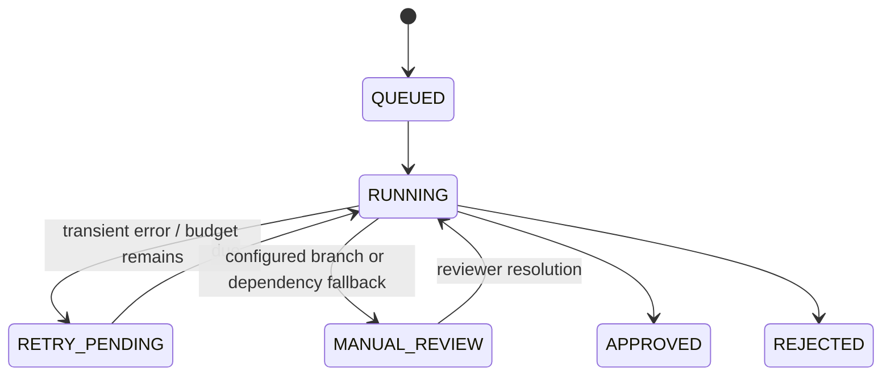

# DecisionForge architecture

## Scope and assumptions

DecisionForge is a generic REST decision engine for trusted workflow authors. Loan
approval and vendor onboarding are examples, not hardcoded business logic. It runs on
one host with SQLite and no external services. The simulated verification adapter is
deliberately local and deterministic. No LLM makes decisions. Python 3.12+ is required.

## Components and data flow

1. A trusted author publishes an immutable, validated workflow version; it becomes
   active for new requests. Existing requests pin both the version and config hash.
2. Intake first checks the global idempotency key and canonical input hash. An exact
   replay returns the existing request even after a schema change. Reusing the key
   for different input returns 409. New input is checked using JSON Schema.
3. Request creation and its first audit event commit together in `QUEUED` state.
   Execution is a separate transaction. A crash between them is recoverable by worker.
4. Execution traverses configured stages. Every rule trace references the payload or
   dependency context. The adapter can return a result, fail transiently, or fail
   permanently. A transient failure schedules a persisted exponential retry.
5. Engine state, dependency outputs, attempts, timestamps and audit events commit
   atomically. An exception rolls back the entire execution transaction. There can
   be no committed decision without its audit event. Queued/due work remains recoverable.
6. A manual review pauses execution. A named actor provides a reason and one of the
   configured decisions; resolution and further execution are one transaction.

## Lifecycle

`RUNNING` is visible in the audit history, but execution commits only at a durable
pause or terminal outcome. Terminal requests are immutable through the API. Attempts
are per dependency stage; total attempts include the first call. Retries have capped
exponential backoff, a persisted due timestamp and no sleeps inside transactions.
Permanent dependency errors and exhausted retry budgets take the configured fallback.

## Consistency and concurrency

SQLite uses WAL, foreign keys, a busy timeout and `BEGIN IMMEDIATE` for writes.
Concurrent API/worker executions serialize, reread state under the write lock, and
skip work that is no longer eligible. A unique idempotency constraint is the final
guard against duplicate intake. A second manual resolution returns 409. Audit events
have per-request sequence numbers and database triggers blocking update/delete.
Immutable workflow rows are protected by equivalent triggers. These are append-only
application guarantees, not tamper-proof storage against a database administrator.

Because the adapter is an in-process simulation, its execution occurs under the
write transaction. This avoids a misleading claim of exactly-once external effects.
A real remote adapter MUST use an outbox, durable attempt/lease records, timeouts and
an idempotency token such as `request_id:stage_id`; release the database lock around
network I/O. Delivery then becomes at-least-once with downstream deduplication.

## Configuration boundaries

Workflows are acyclic directed graphs with explicit dependency/rules/manual/terminal
stage types. All targets must exist, all stages must be reachable, at least one terminal
must exist, and the published version must increase. A node's paths must eventually
terminate; cycles are rejected rather than relying on a runtime loop guard alone.
Rules support typed comparisons, presence, membership, and nested all/any/not groups.
There is no eval, arbitrary Python, URL fetching, template execution or plugin loading.
Missing fields fail comparisons except `exists` and `missing`; booleans are not numbers.

## Trade-offs and scaling

SQLite makes this submission reproducible and makes partial-save recovery easy to
demonstrate, but serializes writers. Use PostgreSQL plus row locks / SKIP LOCKED,
leased workers, an outbox and a queue for multi-host deployments. Keep workflow
versions immutable, route requests to their pinned versions, partition audit events,
and index due jobs. Add metrics for queue age, attempts, dependency latency and
manual-review backlog. No claim of benchmarked production capacity is made.

The worker polls durable state; a queue is an optimization, not the source of truth.
No retry jitter is used so tests and examples are deterministic; use jitter and
per-provider concurrency limits with real dependencies. Audit includes full inputs
to support reproducible decisions; production needs PII minimization, encryption,
retention policies and scoped access. The optional API token is shared authentication,
not RBAC: reviewer and workflow-author roles need separate identities in production.

## Requirement traceability

| Assignment capability | Implementation | Verification |
| --- | --- | --- |
| Structured intake/schema | JSON Schema per version | invalid body/payload tests |
| Mandatory/threshold/branching | Safe rule DSL, staged graph | loan and vendor tests |
| Success/reject/retry/manual | Persisted engine lifecycle | integration and API tests |
| Full state history | Sequenced append-only events | state transition assertions |
| Explainable decisions | Actual/expected values + config/input hashes | explanation snapshots/demo |
| Dependency failure | Deterministic verification simulator | transient/permanent tests |
| Partial save failure | Atomic state+audit transaction | injected audit-write failure |
| Duplicates/idempotency | Canonical hash + unique key | concurrent intake test |
| Changing requirements | Immutable, pinned configurations | version/rule/schema changes |
| Scaling considerations | Explicit single-host trade-offs | this document |
